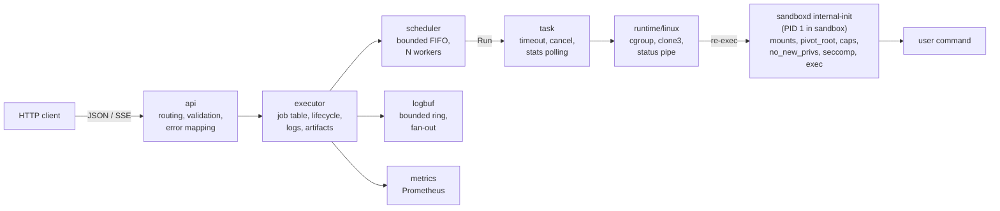

# sandboxd

[](https://github.com/Husqvarnalox/sandboxd/actions/workflows/ci.yml)
[](go.mod)
[](LICENSE)

A small Linux daemon that runs untrusted commands in isolated sandboxes and
exposes them as jobs over HTTP: namespaces, cgroup v2 limits, a read-only
root filesystem, seccomp, a PID 1 supervisor, a bounded queue, streamed logs,
timeouts and cancellation. One static binary, no container engine, no
external dependencies at runtime.

> **Status: experimental (v0.1).** sandboxd is a process-isolation boundary
> built from Linux kernel primitives, the same family of mechanisms
> containers use. It is **not** a virtual machine and does not protect
> against kernel vulnerabilities. Read [docs/SECURITY_MODEL.md](docs/SECURITY_MODEL.md)
> before trusting it with anything hostile.

## Why

Running "a bit of untrusted code" (a test suite, a user-supplied script, a
build step, a plugin) usually means either a full container engine, a
microVM, or `exec` with fingers crossed. sandboxd is the middle ground: the
isolation a container gives you, with a job API designed around what those
workloads actually need:

- a hard answer for "did it finish, how, and how much did it use";
- limits that are in place before the first instruction runs;
- cancellation that kills every descendant, not just the shell;
- logs you can follow live and that cannot fill the daemon's memory;
- backpressure instead of unbounded queues.

## What it is not

- Not a VM boundary. The kernel is shared.
- Not a container engine: no images, no registries, no networking stack, no
  volumes. You give it a directory to use as the root filesystem.
- Not multi-tenant infrastructure. There is no authentication; bind it to
  localhost or put it behind your own gateway.
- Not persistent. Job records live in memory and are lost on restart.

## Isolation at a glance

| Mechanism | What sandboxd does |
|-----------|--------------------|
| Namespaces | Fresh PID, mount, UTS, IPC, network and (by default) user namespace per job. Network has only loopback. |
| cgroup v2 | `memory.max` (+ swap off, OOM group), `cpu.max`, `pids.max`; usage and OOM events read back into the job record. Processes are cloned directly into the cgroup. |
| Filesystem | `pivot_root` into a read-only `nosuid,nodev` rootfs; private `/proc`, minimal `/dev`, tmpfs `/tmp` and `/dev/shm`, writable `/workspace`. |
| Privileges | Empty capability bounding and effective sets, `no_new_privs`, uid 0 mapped to an unprivileged host range (or uid 65534 without user namespaces). |
| seccomp | Deny-list BPF filter applied to all threads: mounts, namespaces, ptrace, bpf, module loading, keyrings, io_uring, time setting and more. |
| Supervisor | sandboxd re-executes itself as PID 1 inside the sandbox: reaps zombies, forwards signals, kills everything on exit. |
| Lifecycle | Timeouts, cancel (TERM, grace, KILL via `cgroup.kill`), bounded FIFO queue with 429 on overflow, graceful shutdown. |

## Architecture



Packages, all under `internal/`:

| Package | Responsibility |
|---------|----------------|
| `job` | Spec validation and limits, state machine, immutable snapshots |
| `scheduler` | Bounded FIFO queue and worker pool; `ErrQueueFull` is the backpressure signal |
| `executor` | Owns jobs end to end: workspace, start, supervise, terminate, finish, cleanup |
| `logbuf` | Per-job bounded log store with non-blocking subscribers |
| `runtime` | The `Runtime`/`Process` interface the executor drives |
| `runtime/linux` | The real thing: namespaces, mounts, capabilities, seccomp, init |
| `cgroup` | cgroup v2 tree: create, limit, stats, kill, remove, stale cleanup |
| `api` | HTTP handlers, JSON shapes, SSE streaming |
| `config`, `doctor`, `metrics` | Flags/env, host preflight, Prometheus registry |

`cmd/sandboxd` is the daemon (`serve`, `doctor`, `version`, and the hidden
`internal-init` entry point). `cmd/sandboxbench` is a small load generator.

## Quick start

Requirements: Linux with cgroup v2 (unified hierarchy), kernel 5.14+
recommended, root. On macOS, use the Docker-based test harness below instead.

```bash
make build                       # bin/sandboxd (static, CGO_ENABLED=0)
./scripts/build-rootfs.sh rootfs # Alpine minirootfs with checksum verification
sudo ./bin/sandboxd doctor --rootfs ./rootfs
sudo ./bin/sandboxd serve --rootfs ./rootfs --state-dir /var/lib/sandboxd
```

Submit a job and follow its output:

```bash
curl -s localhost:8080/v1/jobs -d '{
  "command": ["sh", "-c", "echo hello from $(hostname); id; cat /proc/1/comm"],
  "resources": {"memory_mb": 64, "cpu_millis": 500, "pids": 32},
  "timeout_seconds": 10
}'
```

```bash
curl -N localhost:8080/v1/jobs/<id>/logs?follow=true
```

```
event: stdout
data: {"data":"hello from sandbox\n"}

event: stdout
data: {"data":"uid=0(root) gid=0(root)\n"}

event: stdout
data: {"data":"sandboxd\n"}

event: state
data: {"state":"succeeded","exit_code":0}
```

`scripts/demo.sh` walks through success, timeout, cancellation, an OOM kill
and descendant cleanup against a running daemon.

## API

All responses are JSON. Errors share one shape:

```json
{"error": {"code": "QUEUE_FULL", "message": "job queue is full, retry later"}}
```

| Method and path | Purpose | Notable responses |
|-----------------|---------|-------------------|
| `POST /v1/jobs` | Submit a job | `201` + `Location`; `400 INVALID_REQUEST`, `413 REQUEST_TOO_LARGE`, `429 QUEUE_FULL` (+ `Retry-After`), `503 SHUTTING_DOWN` |
| `GET /v1/jobs` | List jobs (creation order) | |
| `GET /v1/jobs/{id}` | Job record with state, exit code, reason, timestamps, stats | `404 NOT_FOUND` |
| `POST /v1/jobs/{id}/cancel` | Cancel; queued jobs finish immediately, running jobs get TERM then KILL | `202`; `409 JOB_FINISHED` |
| `GET /v1/jobs/{id}/logs` | Retained output as SSE; `?follow=true` streams until the job ends | events `stdout`, `stderr`, `state` |
| `GET /v1/jobs/{id}/artifacts/{path}` | A regular file from `/workspace/artifacts/` of a finished job | `409 JOB_NOT_FINISHED`, `404` for anything outside |
| `DELETE /v1/jobs/{id}` | Remove a finished job and its workspace | `204`; `409 JOB_NOT_FINISHED` |
| `GET /health`, `/ready`, `/version`, `/metrics` | Operational | `/ready` is `503 NOT_READY` when the runtime or shutdown says so |

Request fields: `command` (argv, required), `env` (map), `working_dir`
(default `/workspace`), `network` (`none`, the only mode), `resources`
(`memory_mb` 16–4096, `cpu_millis` 10–16000, `pids` ≤ 4096), and
`timeout_seconds` (1–3600). Defaults: 256 MiB, 1000 millicores, 64 PIDs, 5
minutes. Unknown fields are rejected.

Job states: `queued`, `starting`, `running`, then exactly one of
`succeeded`, `failed`, `cancelled`, `timed_out`. `reason` explains a
non-success: `non_zero_exit`, `signaled`, `oom_killed`, `timeout`, `user`,
`shutdown`, `start_failed`, `runtime_error`.

Log events carry `data` (UTF-8) or `data_base64` (anything else) and
`dropped_bytes` when retention or a slow reader lost output. The final event
of a followed stream is always `state`.

## Configuration

Precedence: command-line flag, then `SANDBOXD_<FLAG>` environment variable
(upper-case, `-` becomes `_`), then the default.

| Flag | Default | Meaning |
|------|---------|---------|
| `--listen` | `:8080` | HTTP address |
| `--rootfs` | (required) | Read-only root filesystem directory |
| `--state-dir` | `/var/lib/sandboxd` | Job workspaces (`jobs/<id>/workspace`) |
| `--cgroup-root`, `--cgroup-name` | `/sys/fs/cgroup`, `sandboxd` | cgroup v2 mount and subtree |
| `--max-concurrent-jobs` | number of CPUs | Running jobs |
| `--max-queue-size` | `256` | Waiting jobs before `429` |
| `--max-log-bytes` | `4 MiB` | Output retained per job |
| `--max-request-bytes` | `1 MiB` | Request body limit |
| `--shutdown-timeout` | `30s` | Grace for running jobs on SIGTERM/SIGINT |
| `--kill-grace-period` | `5s` | SIGTERM to SIGKILL on cancel/timeout |
| `--userns` | `true` | User namespace per job |
| `--host-uid-base` | `100000` | Start of the 65536-id host range mapped into sandboxes |
| `--sandbox-uid` | `65534` | Workload uid/gid when `--userns=false` |
| `--hostname` | `sandbox` | Hostname inside jobs |
| `--log-level`, `--log-format` | `info`, `text` | slog level and `text`/`json` |

Logs never include environment variable values or command arguments beyond
`argv[0]`.

## Observability

Prometheus metrics at `/metrics` (no per-job labels, so cardinality is
fixed): `sandboxd_jobs_total{status}`, `sandboxd_job_duration_seconds`,
`sandboxd_job_queue_wait_seconds`, `sandboxd_job_start_latency_seconds`,
`sandboxd_job_cpu_seconds`, `sandboxd_job_memory_peak_bytes`,
`sandboxd_job_oom_total`, `sandboxd_job_timeout_total`,
`sandboxd_job_cancel_total{reason}`, `sandboxd_job_start_failures_total`,
`sandboxd_cleanup_failures_total`, `sandboxd_queue_rejected_total`,
`sandboxd_jobs_active`, `sandboxd_jobs_queued`, plus the standard Go and
process collectors.

`sandboxd doctor` checks the host before you start: kernel, root, cgroup v2
mount and controllers, delegation, `cgroup.kill`, `memory.peak`, user
namespaces and uid range, seccomp, rootfs layout, state directory and that
the binary is executable by the sandbox uid. It changes nothing.

## Development

```bash
make test             # go test ./...
make test-race        # go test -race ./...
make lint             # gofmt, go vet (darwin and linux/amd64, linux/arm64)
make test-integration # Linux integration + e2e suite in a privileged container
```

Everything above `internal/runtime/linux` and `internal/cgroup` is
platform-independent and tested against an in-memory fake runtime, so unit
tests run on macOS or Linux. The Linux suite (`-tags integration`) needs
root, cgroup v2 and a rootfs; `scripts/test-linux.sh` provides all three
inside `golang:1.26-alpine` with `--privileged --cgroupns=private`, then
runs `sandboxd doctor`, a real daemon and `scripts/demo.sh` against it.

`cmd/sandboxbench` submits many jobs concurrently and prints latency
percentiles; it has no bundled numbers because they would only describe the
machine they were measured on.

## Documentation

- [docs/SECURITY_MODEL.md](docs/SECURITY_MODEL.md): threat model, boundaries,
  non-goals, known limitations.
- [docs/INVARIANTS.md](docs/INVARIANTS.md): the properties the code
  guarantees and the test that checks each one.
- [docs/ROADMAP.md](docs/ROADMAP.md): rootless mode, persistence, network
  modes, allow-list seccomp, OCI rootfs.
- [CHANGELOG.md](CHANGELOG.md), [CONTRIBUTING.md](CONTRIBUTING.md),
  [SECURITY.md](SECURITY.md).

## License

Apache-2.0. See [LICENSE](LICENSE).
